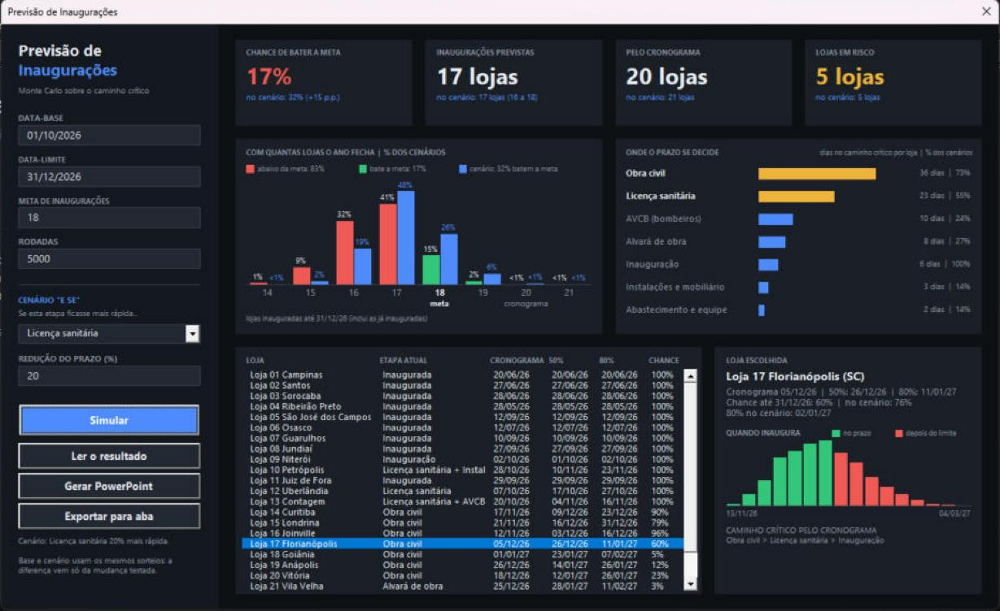
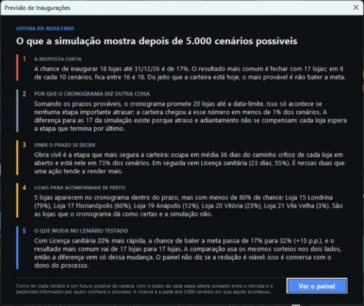
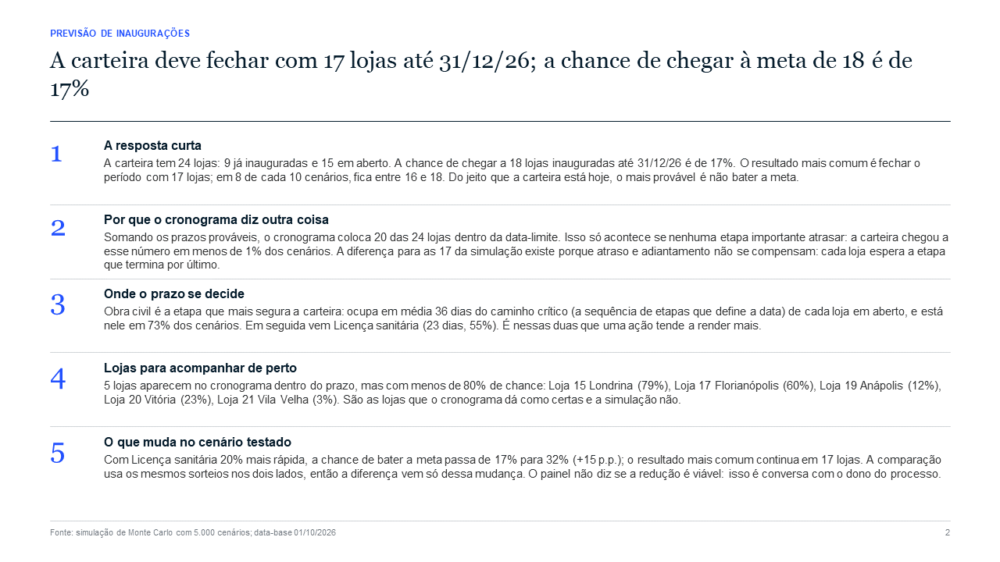
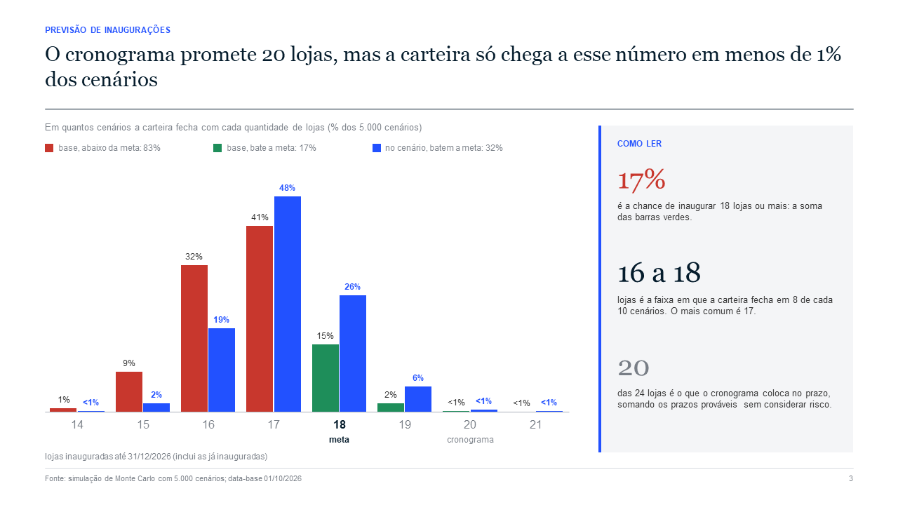
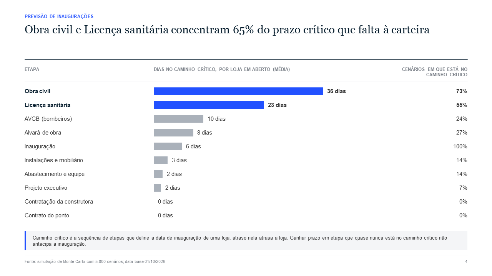
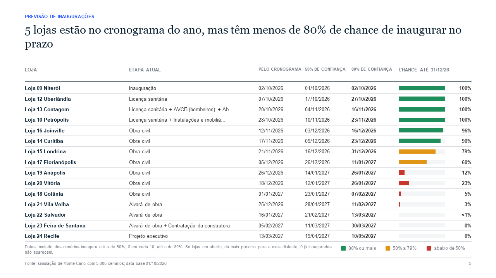
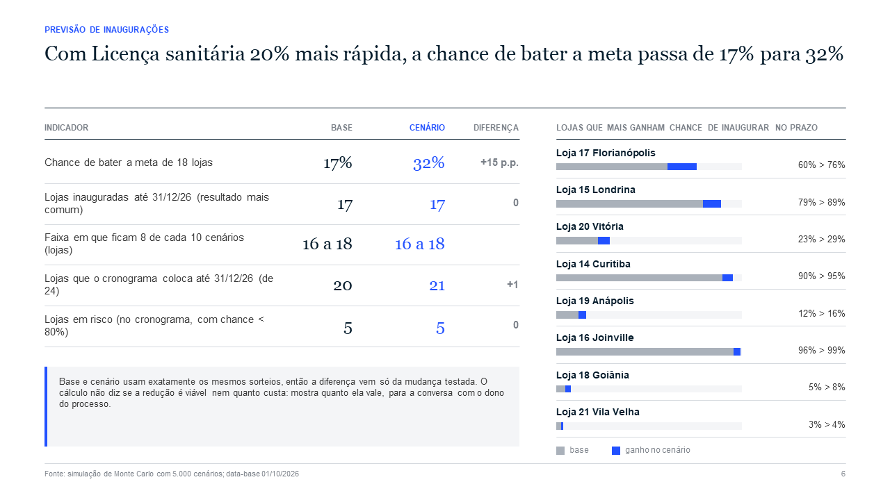

# Previsão de Inaugurações

Um painel em Excel que responde à pergunta que todo PMO de expansão ouve: **quantas lojas a gente inaugura até o fim do ano, e com que chance?**

Ele calcula o caminho crítico de cada loja e simula a carteira milhares de vezes (Monte Carlo), sorteando o prazo de cada etapa entre o otimista e o pessimista. É VBA puro: sem suplementos, sem DLLs, sem conexão externa.

> Este repositório é uma vitrine: mostra o que o projeto faz, como foi construído e como foi testado. O código-fonte não é público.

## O que o painel responde

Com a base fictícia do projeto (24 lojas, 240 etapas, vista em 01/10/2026):

| Pergunta | Resposta do painel |
|---|---|
| Quantas lojas o cronograma coloca até 31/12? | 20 das 24 |
| Quantas a simulação prevê? | 17 (em 8 de cada 10 cenários, entre 16 e 18) |
| Qual a chance de bater a meta de 18? | 17% |
| Onde o prazo se decide? | Obra civil e licença sanitária |
| E se a licença sanitária saísse 20% mais rápido? | A chance sobe para 32% |

O cronograma soma os prazos prováveis e promete 20 lojas. Só que atraso e adiantamento não se compensam: cada loja espera a etapa que termina por último, e os prazos têm mais espaço para estourar do que para encurtar. A simulação mostra o tamanho dessa diferença antes de ela aparecer no resultado.

## O que tem no painel

- **Indicadores**: chance de bater a meta, o que a simulação prevê, o que o cronograma promete e as lojas em risco (as que o cronograma dá como certas, mas têm menos de 80% de chance).
- **Com quantas lojas o ano fecha**: em quantos cenários a carteira terminou com 14, 15, 16... lojas, com o percentual em cada barra.
- **Etapas que mais seguram o prazo**: quantos dias cada tipo de etapa ocupa no caminho crítico e em quantos cenários ela está nele.
- **Tabela de lojas**: etapa atual, data pelo cronograma, datas com 50% e 80% de confiança e chance até o limite.
- **Loja escolhida**: a distribuição da data de inauguração e as etapas que definem a data.
- **Cenário "e se"**: escolha uma etapa e uma redução de prazo; o painel compara base e cenário usando exatamente os mesmos sorteios, então a diferença vem só da mudança testada.

### Leitura do resultado em linguagem simples

Depois de cada simulação abre uma tela que explica os números para quem não conhece o método. O texto é montado a partir do resultado, não é fixo.

### Apresentação em PowerPoint

Um botão monta a apresentação no padrão de consultoria: o título de cada slide é a conclusão, escrita a partir dos números, com um assunto por página e a fonte no rodapé. Os gráficos são desenhados com formas, sem imagens coladas.

## Como funciona

**Entrada.** Duas tabelas do Excel: as lojas (com a data de início do projeto) e as etapas de cada loja, com predecessoras, três estimativas de prazo (otimista, provável e pessimista) e a data real de conclusão das que já terminaram.

**Caminho crítico.** A data de cada etapa é a maior data de término das predecessoras mais a duração. A data da última etapa é a inauguração. Voltando da inauguração pela predecessora que terminou por último, chega-se ao caminho crítico.

**Sorteio dos prazos.** Cada etapa aberta recebe uma duração sorteada de uma distribuição triangular. Para uma etapa em andamento, só valem as durações maiores que o tempo já gasto. Se a etapa já passou do pessimista, a estimativa original não serve mais e o modelo assume que falta 20% de um prazo novo.

**Gerador de números.** O projeto usa um gerador próprio (Park-Miller) em vez do `Rnd` do VBA. A mesma semente repete exatamente o mesmo resultado em qualquer máquina, e o cenário reusa os sorteios da simulação base.

**Desempenho.** 5.000 cenários da base de exemplo levaram 0,3 segundo no Excel em que o projeto foi conferido.

## Como foi construído

| Parte | Papel |
|---|---|
| Motor de simulação | Caminho crítico, Monte Carlo, percentis e gargalos. Só trabalha com matrizes, sem tocar em células. |
| Camada de dados | Única parte que lê e grava células: tabelas e premissas. Confere o cadastro e explica o que estiver errado. |
| Classe de simulação | Guarda o resultado de uma simulação. O painel mantém duas instâncias: base e cenário. |
| Classe de gráfico | Área de desenho no formulário: barras e textos feitos com rótulos, reaproveitados a cada desenho. |
| Classe de controle | Liga os controles criados em tempo de execução aos seus eventos (`WithEvents`). |
| Formulários | O painel e a tela de leitura. Todos os controles são criados por código, sem nada desenhado no editor. |
| Narrativa | Monta os textos da leitura e dos slides a partir dos números. |
| Apresentação | Conteúdo e layout dos slides, com ligação tardia ao PowerPoint (sem referência de biblioteca). |

## Como foi testado

O motor não depende do Excel, então o mesmo VBA roda fora dele em testes automáticos. São dois níveis.

**Testes do motor (32 conferências).** O gerador de números contra o valor de referência de Park-Miller, a distribuição triangular, o tratamento de etapas em andamento, o caminho crítico de uma rede pequena de resposta conhecida, a recusa de cadastros errados e as propriedades da simulação (mesma semente repete o resultado; reduzir um prazo nunca atrasa uma loja).

**Teste de ponta a ponta (63 conferências).** Uma macro roda a simulação dentro do Excel, grava todos os números e exporta para a aba e para o PowerPoint. Um script lê esses arquivos e confere:

| Pergunta | Resultado na base de exemplo |
|---|---|
| O motor dá o mesmo resultado no Excel e no LibreOffice? | Idêntico, número a número |
| Uma reimplementação independente em Python chega ao mesmo resultado? | Sim: 17,75% com 400 mil cenários, contra 16,78% do Excel com 5 mil, dentro da margem de erro |
| Quanto o resultado muda de uma semente para outra? | Com 5.000 cenários, cerca de 1 ponto percentual para mais ou para menos |
| Os slides e a aba mostram o que o painel calculou? | Sim, em todos os números conferidos |

Margem de erro da chance de bater a meta, medida com 200 sementes: 3,5 p.p. com 500 cenários, 2,4 com 1.000, 1,0 com 5.000 e 0,5 com 20.000.

## Limites do modelo

- A previsão é tão boa quanto as três estimativas: se elas forem otimistas, o resultado também será.
- Os prazos das etapas são sorteados de forma independente. Na prática, atrasos andam juntos, o que tende a alargar a faixa de resultados.
- Etapas concluídas entram com a data real; o modelo não aprende com o histórico de atrasos para corrigir as estimativas.
- Os dados de exemplo são fictícios.

## Autor

Davi Lima. Analista de planejamento, PMO de expansão. [LinkedIn](https://www.linkedin.com/in/davi-lima-362723214/)

Todos os direitos reservados.
